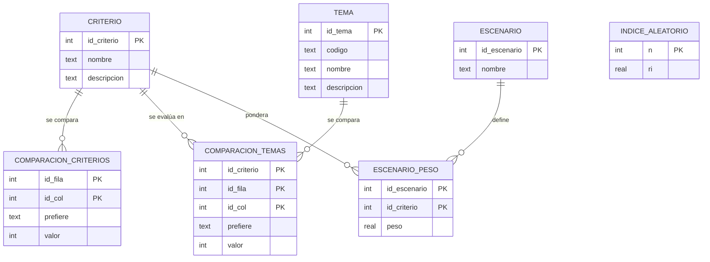

# Módulo 4: AHP del Módulo 1 resuelto con SQL

**Cátedra:** Técnicas y Herramientas Modernas II, Ingeniería Industrial, Facultad de Ingeniería, UNCuyo  
**Tema general:** Optimización de procesos industriales con IA para la eficiencia energética (ISO 50001)  
**Integrantes:** Pedro Elizalde, Matteo Pratelesi, Francisco Allamand, Francisco Peiro

## Relación con el Módulo 1

En el [Módulo 1](https://github.com/pedroelizalde05/TyHM2_modulo1/tree/main/M%C3%B3dulo%201) se eligió el tema del proyecto final con el método AHP, usando una planilla de Excel ([readme del Módulo 1](https://github.com/pedroelizalde05/TyHM2_modulo1/blob/main/M%C3%B3dulo%201/readme.md)). Ganó el **Tema C: detección de anomalías energéticas con IA (Green AI)**.

En este módulo se pasa esa misma decisión a una **base de datos SQL**. Los juicios por pares se guardan en tablas, y los pesos, la consistencia, el ranking y la sensibilidad son vistas que se recalculan solas si cambia un juicio.

**No se agregó ningún dato nuevo.** Todos los juicios son los de la planilla del Módulo 1. Por eso el resultado debe dar igual, y eso sirve de validación: la base reproduce el ranking, los pesos y la consistencia de la planilla.

## Modelo de datos

- **Tablas:** `criterio`, `tema`, `comparacion_criterios`, `comparacion_temas`, `escenario`, `escenario_peso` e `indice_aleatorio` (tabla RI de Saaty).
- Solo se carga la mitad de arriba de cada matriz de comparación. Los recíprocos y la diagonal los genera la vista `v_matriz_criterios` (y `v_matriz_temas`).
- **Vistas:** `v_pesos_criterios`, `v_consistencia_criterios`, `v_consistencia_temas`, `v_prioridad_local`, `v_puntaje_global`, `v_ranking`, `v_aporte`, `v_escenarios` y `v_peso_critico`.
- El vector propio se calcula con el **método de las potencias, 25 iteraciones**, con una consulta recursiva (`WITH RECURSIVE`). Es el mismo método que usa la planilla del Módulo 1.

## Resultados

### Pesos de los criterios (CR = 1,73 %, menor a 10 %: consistente)

| Criterio | Peso |
| :--- | :---: |
| Pertinencia | 25,48 % |
| Viabilidad | 25,48 % |
| Datos | 19,69 % |
| Impacto | 14,68 % |
| Caso real (factibilidad temporal) | 14,68 % |

### Ranking final

| Posición | Tema | Puntaje |
| :---: | :--- | :---: |
| 1 | **C: Detección de anomalías con Green AI** | **49,09 %** |
| 2 | A: Predicción de consumo con ML | 33,53 % |
| 3 | B: Optimización de setpoints con RL | 17,37 % |

Los valores son idénticos a los del Módulo 1. Además, se comprobó contra un cálculo independiente del vector propio exacto (diferencia menor a 1e-15).

### Sensibilidad: ¿cambia el ganador si cambian los pesos?

| Escenario | Tema A | Tema B | Tema C | Ganador |
| :--- | :---: | :---: | :---: | :---: |
| Base (AHP) | 33,53 | 17,37 | **49,09** | C |
| Viabilidad baja | 35,19 | 15,83 | **48,99** | C |
| Pesos iguales | 32,85 | 19,27 | **47,89** | C |
| Impacto alto | 30,83 | 22,07 | **47,11** | C |
| Caso real alto | 37,17 | 16,04 | **46,79** | C |
| Sin Viabilidad | 30,54 | 19,69 | **49,77** | C |

El Tema C gana en los 6 escenarios. La vista `v_peso_critico` calcula, para cada criterio, qué peso tendría que alcanzar para que otro tema supere al C, y el resultado es que ninguno lo logra. Se confirmó también con un barrido numérico de 0 % a 100 % del peso de cada criterio. Esto pasa porque el C nunca queda por debajo de A ni de B en ningún criterio. Con el peso de un solo criterio en 100 % puede haber un **empate** (por ejemplo, con Datos, A = C), pero ningún rival lo supera.

## Cómo usarlo

1. Instalar [DB Browser for SQLite](https://sqlitebrowser.org) (gratis).
2. Abrir `ahp_modulo1.db`. La base ya está construida.
3. Ir a la pestaña **Ejecutar SQL**, pegar una consulta de `consultas.sql` y apretar Ctrl+Enter.
4. Para probar cómo se recalcula todo, cambiar un juicio. Hay un ejemplo comentado al final de `consultas.sql`.

Para reconstruir la base desde cero: `sqlite3 ahp_modulo1.db < ahp_modulo1.sql`. Hace falta SQLite 3.25 o superior.

## Archivos

| Archivo | Contenido |
| :--- | :--- |
| `ahp_modulo1.sql` | Script completo: tablas, datos del Módulo 1 y vistas del AHP y la sensibilidad |
| `ahp_modulo1.db` | Base SQLite ya construida |
| `consultas.sql` | Consultas para ver los resultados |
| `README.md` | Este documento |

## Límites

- Los juicios son subjetivos y salen del Módulo 1. Este módulo cambia la herramienta, no los datos.
- La planilla del Módulo 1 no guardó el motivo de cada juicio, por eso las tablas no tienen una columna de razones.
- El peso crítico se calcula con la fórmula directa de la planilla, no con un barrido de pasos fijos.
